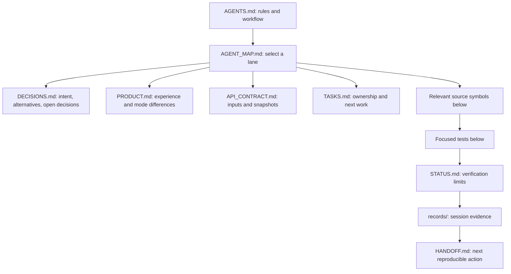
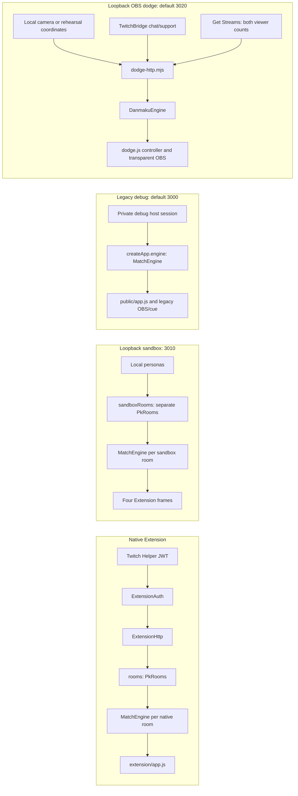

# Agent navigation map

Checked against source at `b5c81e1` on 2026-10-31. This is a navigation cache,
not proof that code stayed unchanged. Start with [AGENTS.md](../AGENTS.md) and
the current part of [handoff](HANDOFF.md); earlier handoff sections are history.
Dodge controller/test pointers were refreshed with UI commit `e860205`; the
runtime graph and backend contracts remain unchanged by that frontend update.
Dodge engine test coverage was expanded from base `13b0aa4`: controlled marker
movement, pause/cooldown boundaries, audience windows/recovery, interrupted lead,
knockout/reset and snapshot isolation. The existing engine test pointer applies;
no runtime edge or contract changed.
The 2026-10-31 horizontal-lane implementation changes dodge trajectory behavior
since the reviewed baseline: `DanmakuEngine.spawn` selects fixed cycling lanes,
while `tick` still performs swept marker collision. See the current runbook and
handoff for behavior and verification state.
The 2026-11-02 live-setup revision (base `e91c6fb`) adds readiness and chat receipt
diagnostics to `dodge-http.mjs`, camera-first live UI, and `dodge-setup.mjs` for
offline config/read-only Twitch checks. Start/Resume live gating and additive
snapshot fields are documented in the contract. Follow `test/dodge-live.test.mjs`,
`test/dodge-setup.test.mjs` and the existing HTTP/UI suites for this boundary.

## Read according to the task

2026-11-03 recording addition from base `cfd7a8e`: `DanmakuEngine({mode:'ai-demo'})`
and matching server/launcher/doctor options support one real chat against labelled
local AI; default mode is `duel`. AI owns marker B; real counts/marker A still gate
Start. Follow [contract](API_CONTRACT.md), [runbook](dodge-runbook.md),
`test/dodge-ai.test.mjs` and AI UI coverage. The current under-three-minute recording
plan is [demo-runbook.md](demo-runbook.md); it supersedes that file's legacy host plan.



| Need | Read next | Do not assume |
| --- | --- | --- |
| What we chose and why | [Decisions](DECISIONS.md), then the linked design/source | A brainstorm alternative is an approved feature |
| Numerical dodge rules and setup | [Dodge runbook](dodge-runbook.md) | Proposed values in historical discussion are current |
| Module/data relationships | [Architecture](ARCHITECTURE.md), graph below | Shared module code means shared match state |
| Request/auth/snapshot changes | [Contract](API_CONTRACT.md) | A native request can use local synthetic identity |
| Accounts, tokens, Extension setup | [Configuration](configuration-guide.md), [Extension setup](twitch-extension-setup.md) | App secret, user token and Extension secret are interchangeable |
| Collaboration and task assignment | [Tasks](TASKS.md), [AGENTS.md](../AGENTS.md) | Lane names launch agents or grant file ownership automatically |
| Actual completion/evidence | [Status](STATUS.md), latest [record](../records/README.md) | Passing mocks establishes real Twitch/OBS acceptance |
| Hackathon Twitch proof and submission gaps | [Readiness](hackathon-readiness.md) | Local simulation alone establishes a submission-ready Twitch connection |
| Hackathon sources/ideation provenance | [Redacted sources](../records/sources-2026-10-31.md) | Setup credentials can be copied or published |

## Four runtime boundaries



`server.mjs` hosts native/legacy routing; the sandbox launcher opts into a
separate registry in its own process. Dodge uses a different server/process.
The same `/overlay/a` path means legacy state on 3000 and dodge state on 3020;
it never implies native-room OBS support. Native scores count volleys; dodge
results compare remaining health. Never copy one mode's cooldown/rules into
another without an explicit product change. Ports are defaults, not discovery.

## Task to source and tests

Open the owning symbol and its callers/test cases. Widen only when the contract
crosses a boundary. Paths are stable search anchors; line numbers deliberately
are not cached here.

| Task | Owning source / symbols | Focused verification files |
| --- | --- | --- |
| Native invite, accept, ready, membership | [pk-rooms.mjs](../src/pk-rooms.mjs): `PkRooms.invite`, `action`, `play`, `tick`, `state` | [pk-rooms.test.mjs](../test/pk-rooms.test.mjs), [extension-http.test.mjs](../test/extension-http.test.mjs) |
| Native/legacy charge, defection, score/timers | [engine.mjs](../src/engine.mjs): `MatchEngine.command`, `discharge`, `tick`, `snapshot` | [engine.test.mjs](../test/engine.test.mjs), native room tests |
| Native signed identity and role checks | [extension-auth.mjs](../src/extension-auth.mjs): `ExtensionAuth.verify`, `requireBroadcaster`, `requireLinkedViewer` | [extension-auth.test.mjs](../test/extension-auth.test.mjs), HTTP auth cases |
| Native HTTP, personas, registry isolation | [extension-http.mjs](../src/extension-http.mjs): `authenticate`, `mint`, `handle`; [server.mjs](../server.mjs): `createApp` | [extension-http.test.mjs](../test/extension-http.test.mjs) |
| Native frontend state/actions | [extension/app.js](../extension/app.js), [index.html](../extension/index.html), [styles.css](../extension/styles.css) | [extension-ui.test.mjs](../test/extension-ui.test.mjs), [extension-integrated-ui.test.mjs](../test/extension-integrated-ui.test.mjs) |
| Four-role simulator layout/launcher | [sandbox.html](../public/sandbox.html), [sandbox.js](../public/sandbox.js), [sandbox-server.mjs](../scripts/sandbox-server.mjs) | Native integrated/HTTP tests, then real-browser four-role check |
| Legacy debug/OBS/cue or saved settings | [server.mjs](../server.mjs): `createApp`; [public/app.js](../public/app.js); [store.mjs](../src/store.mjs) | [server.test.mjs](../test/server.test.mjs), [ui.test.mjs](../test/ui.test.mjs) |
| Twitch identity lookup | [twitch-directory.mjs](../src/twitch-directory.mjs): `TwitchDirectory` | Native HTTP/room tests with injected directory |
| Twitch reconnect, dedupe, support/moderation | [twitch.mjs](../src/twitch.mjs): `TwitchBridge.validate`, `handle`, `fail`, `stop` | [twitch.test.mjs](../test/twitch.test.mjs), consuming room/dodge HTTP cases |
| Dodge collision, allegiance, admission, barrage | [danmaku.mjs](../src/danmaku.mjs): `sweptHit`, `DanmakuEngine.activity`, `tick`, `audience`, `moderate` | [danmaku.test.mjs](../test/danmaku.test.mjs) |
| Dodge routes, live/synthetic boundary, counts | [dodge-http.mjs](../src/dodge-http.mjs): `createDodgeServer`, `sampleAudience`; [dodge-server.mjs](../scripts/dodge-server.mjs) | [dodge-http.test.mjs](../test/dodge-http.test.mjs) |
| Live dodge readiness/diagnostics and read-only connection check | [dodge-http.mjs](../src/dodge-http.mjs): `readiness`, chat counters; [dodge-setup.mjs](../src/dodge-setup.mjs): `inspectDodgeConfig`, `verifyDodgeConnection`; [doctor-dodge.mjs](../scripts/doctor-dodge.mjs) | [dodge-live.test.mjs](../test/dodge-live.test.mjs), [dodge-setup.test.mjs](../test/dodge-setup.test.mjs), existing dodge UI/HTTP suites; real Twitch/OBS acceptance separately |
| Camera detection, crop/mirror, loss | [tracker.js](../public/dodge/tracker.js): `findMarker` and camera lifecycle; [track.html](../public/dodge/track.html) | Colour tests in dodge HTTP suite; browser video pipeline; physical camera check separately |
| Dodge rendering/controller/OBS | [dodge.js](../public/dodge/dodge.js): `drawArena`, `renderControls`, `renderFeed`, synthetic quick-start; [index.html](../public/dodge/index.html), [dodge.css](../public/dodge/dodge.css), [overlay.html](../public/dodge/overlay.html) | [dodge-ui.test.mjs](../test/dodge-ui.test.mjs) for DOM/local HTTP, then real-browser controls/mobile/reconnect/transparent output; [UI review](design/2026-10-31-dodge-ui-review.md); OBS hardware separately |
| Extension packaging/judge access | [package-extension.mjs](../scripts/package-extension.mjs): `parseOptions`, `stripLocalSimulator`, `collectAssets`; [setup](twitch-extension-setup.md) | Local `--check`/actual ZIP review; packaging regression task remains open |
| Public deployment/config diagnosis | [public-test-server.mjs](../scripts/public-test-server.mjs), [doctor-extension.mjs](../scripts/doctor-extension.mjs), [cloud deployment](cloud-deploy.md) | [public-test-server.test.mjs](../test/public-test-server.test.mjs), doctor; actual public HTTP/Twitch separately |
| Session evidence and handoff | [Records skill](../.agents/skills/chatcrossfire-records/SKILL.md), [record template](../records/TEMPLATE.md) | Link/content checks, accurate identity, Google readback if available |

For a row's focused check use `node --test` followed by its test paths. Required
final checks are in AGENTS.md; prose-only changes need link/content/diff checks.
Browser helper files and screenshots under ignored `artifacts/` are local
evidence and do not arrive in a clone; reproduce from the runbook.

## Keeping the map useful

Before relying on a cached claim, compare the listed baseline to the checkout:

```powershell
git status --short
git branch --show-current
git rev-parse HEAD
git diff --name-only b5c81e1 HEAD -- src public extension server.mjs scripts test
```

Also inspect uncommitted changes in the selected lane. Use `rg -n` for symbols
and read the relevant code/tests; do not reread every module or browse all past
records as a default. If a changed import/route crosses a boundary, follow that
edge to its producer/consumer. Never use a stale map to skip source verification.

When changing a dependency, entry point or rule, update the affected row/edge,
its contract and evidence pointer in the same change. Add confirmed decisions
to DECISIONS.md; leave concrete tuning values in the runbook/source to avoid
duplicated constants. Keep history in records instead of expanding this map
with chronological chat transcripts. New agents need this branch or a checkout
containing these files; local skill discovery alone does not synchronize peers.
