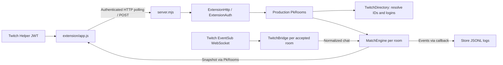

# Current architecture

Baseline: `dd440d63a63616c28e7de50b080ea1e396bcdf9b`, audited 2026-10-30–31 (Asia/Singapore).
See [API contract](API_CONTRACT.md) for concrete request/state shapes.

## Local OBS dodge mode

Added 2026-10-31 on `codex/integrator-danmaku-dodge`: `scripts/dodge-server.mjs`
starts a separate loopback HTTP server. `src/danmaku.mjs` owns authoritative
physics/health/pressure; `src/dodge-http.mjs` accepts trusted local marker/operator
input, routes actual Twitch identities and samples both viewer counts. The
controller, colour-camera tracker and transparent overlays live in `public/dodge/`.
Camera frames remain in the tracking browser; only coordinates reach the server.
All simulation state is in memory and disappears on restart.

The new server never reads or mutates native, sandbox or legacy MatchEngine
instances. The existing Twitch bridge gains opt-in support/moderation event
subscriptions; old consumers retain their default subscription behavior.
No framework, runtime dependency, model download or generated production asset
was introduced. See [dodge runbook](dodge-runbook.md) for setup and remaining
remote/VTuber/physical hardware limitations.

## Native Extension flow

`server.mjs` runs a 250 ms tick. Twitch sends refreshed JWTs to the Helper callback;
the frontend uses the latest token. Visible clients normally poll every second,
back off on errors, and suspend polling when hidden. Frontend generation checks
keep an earlier poll from overwriting a later action/authentication cycle.

`ExtensionAuth` verifies HS256 with the decoded Base64 Extension shared secret,
expiration and relevant claims. Broadcaster ownership requires the authenticated
channel owner. Viewers need a shared numeric Twitch identity for participation.
Twitch Extension credentials and the chat application's OAuth token are separate.
The existing directory lookup also requires the backend OAuth user token, so
native invitation currently cannot operate with only an Extension secret.

`PkRooms` reserves both channels during an invitation and rechecks after async
lookup to handle racing invites. Default capacity is 8 nonterminal rooms. Each
accepted room may create its own chat bridge; chat and buttons mutate the same
room engine. Native play does not wait for the optional chat bridge to connect.

`TwitchBridge` validates a User Access Token, resolves both channels, subscribes
to `channel.chat.message`, handles keepalive, Twitch-requested migration and
unexpected reconnect, filters duplicate IDs and Shared Chat copies, and rate-limits
replies. It revalidates hourly. Refresh-token renewal is not implemented.
Per-room connections sharing one OAuth identity need platform-limit review before
expanding beyond the two-streamer demo.

## Three independent state paths

| Path | Backend state | Frontend transport | Identity |
| --- | --- | --- | --- |
| Native Extension | `ExtensionHttp.rooms`, engine per PK | `/api/extension/*`, HTTP polling | Twitch JWT |
| Local four-role sandbox | `ExtensionHttp.sandboxRooms`, separate engines | Same Extension API | Loopback-only simulated bearer sessions |
| Legacy debug/OBS/cue | Top-level `createApp().engine` and `.bridge` | `/api/state`, `/api/events` SSE, protected POSTs | Debug host session for mutation |

The legacy `/overlay/a`, `/overlay/b`, and `/cue/*` pages read only the legacy
engine. They do not subscribe to `PkRooms`. Native `overlay.html` runs inside the
Twitch Extension with Helper authorization. A standalone OBS browser source does
not receive that native identity automatically. An OBS view of native rooms would
require a separately scoped design for read-only room access; none exists today.

## File responsibilities

| Files | Responsibility |
| --- | --- |
| `server.mjs` | HTTP routes, Host/CORS, static assets, legacy sessions/SSE, shared ticking |
| `src/extension-http.mjs`, `src/extension-auth.mjs` | Native routes, token verification, isolated sandbox sessions |
| `src/pk-rooms.mjs` | Pairing, invitation/readiness lifecycle, room access, chat binding |
| `src/engine.mjs` | Authoritative gameplay, clocks, challenges, points, snapshots |
| `src/twitch.mjs`, `src/twitch-directory.mjs` | EventSub/Helix lifecycle and channel lookup |
| `src/store.mjs` | Atomic legacy config and bounded event logs |
| `extension/` | Native panel/dashboard/config/overlay source |
| `public/` | Landing, explicit sandbox launcher, legacy console/OBS/cue |
| `scripts/` | Local/public launchers, verification, two-role smoke scripts, ZIP packaging |
| `test/` | Controlled-clock, synthetic transport/HTTP/JWT, and jsdom tests |

## Persistence, packaging, deployment

`data/config.json` persists legacy configuration. `data/events.jsonl` logs events
with rotation at about 5 MB and one prior file. Neither restores native rooms or
an in-progress match after process restart. Terminal rooms are retained in memory
for up to an hour, with a history cap of 64.

Run one long-lived Node process behind HTTPS. Public origin configuration disables
legacy developer APIs by default; explicitly keep `ENABLE_DEBUG=0` and
`ENABLE_SANDBOX=0`. Exact Extension CDN CORS and Twitch backend URL allowlisting
must agree. Docker runs Node 24 with no production npm dependency install.

The packager reads only native frontend sources, creates 8 root-level ZIP assets,
generates public backend configuration, and strips marked simulation code from
production. It does not read `.env`. Changing backend origin requires repackaging
and updating Twitch's allowed URL configuration.

Official background checked during audit:
[Extension JWT/identity](https://dev.twitch.tv/docs/extensions/required-technical-background/),
[Helper callbacks](https://dev.twitch.tv/docs/extensions/reference/),
[User-token WebSocket authentication](https://dev.twitch.tv/docs/chat/authenticating/).
